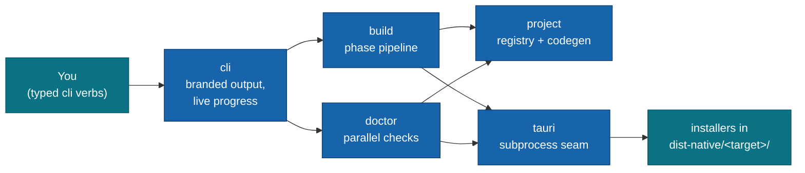

# @moku-labs/native

**Compose system plugins, get native installers — the entire permission surface is codegenned, never hand-maintained.**

`@moku-labs/native` is the Moku family's node-only native packager: a [`@moku-labs/core`](https://github.com/moku-labs/core) Layer-2 framework that wraps [Tauri 2](https://v2.tauri.app) end-to-end. It generates a gitignored Tauri project, codegens the permission surface (Tauri capabilities, the `Info.ios.plist` sidecar, `AndroidManifest.xml` needs) from whichever system plugins your app composed, and drives `tauri build` for all five targets — macOS, Windows, Linux, iOS, Android. It is not a runtime and ships nothing inside your app: the generated Tauri project is disposable build output, never committed source.

<br/>

[](https://www.npmjs.com/package/@moku-labs/native)
[](#requirements)
[](#requirements)
[](https://github.com/moku-labs/core)
[](./LICENSE)

<br/>

[Quick start](#quick-start) · [Two apps, one contract](#two-apps-one-contract) · [Plugins](#plugins) · [Configuration](#configuration) · [Signing and store builds](#signing-and-store-builds) · [Debug builds](#debug-builds) · [Dev profile](#dev-profile) · [iOS simulator](#ios-simulator) · [Events](#events) · [Docs](#docs)

---

## Why @moku-labs/native

- **The composition IS the permission surface.** Declare `{ name: "notification" }` once in `config.system` and the capability registry resolves it into npm/crate dependencies, Rust plugin init, capability JSON, and mobile permission needs — no hand-edited `tauri.conf.json`, no drifting plist.
- **Generated, gitignored, regenerable.** `.moku/tauri/` is build output, not source. Delete it, run a build, and the write-if-changed generators reproduce it byte-for-byte — the "minimal troubles" promise lives here.
- **One subprocess seam.** Only the `tauri` plugin spawns processes — everything reaching `@tauri-apps/cli` goes through its argv builders, entropy-gated secret scrubbing, error taxonomy, and process-group dev lifecycle.
- **A packager, not a runtime.** Node-only, the deploy/CLI analogue for native packaging. Nothing here executes inside your shipped app; your web app stays exactly what it was.
- **Secrets stay in env vars.** Config carries env-var *references* only (`signing.android.keystorePasswordEnv`), doctor checks presence without reading values, and every subprocess output line is scrubbed before it can reach a log.

## Quick start

```sh
bun add @moku-labs/native @moku-labs/core @moku-labs/common
```

> [!NOTE]
> **Status: `0.x` — early.** `@moku-labs/core` (`^1.7.1`) and `@moku-labs/common` (`^0.3.4`) are peer dependencies — install them beside the package, as above. A real `node` binary on PATH is a hard prerequisite (`@tauri-apps/cli` cannot run under bun); `native doctor` checks it.

A native app is its own `createApp` — typically `src/native.ts`, beside your web app:

```ts
// src/system.ts — the system-plugin composition, shared with your web app
export const systemPlugins = [{ name: "store" }, { name: "deep-link" }];
```

```ts
// src/native.ts — the native createApp (Layer 3)
import { createApp } from "@moku-labs/native";
import { systemPlugins } from "./system";

export const native = createApp({
  config: {
    app: { name: "MyApp", identifier: "com.example.myapp", icon: "assets/icon.png" },
    web: {
      build: "bun run build",
      devCommand: "bun run dev", devUrl: "http://localhost:5173",
      dist: "dist"
    },
    system: systemPlugins,
    capabilities: { "deep-link": { mode: "scheme", scheme: "myapp" } },
    targets: ["macos", "ios"] // default: the host's own desktop target — mobile is opt-in
  }
});
```

`app.icon` is a 1024×1024 PNG. Leave it out and a placeholder is generated, so a brand-new app packages before anyone has drawn an icon.

```ts
// scripts/native-build.ts — one thin script per verb
import { native } from "../src/native";

await native.start();
await native.cli.build({ target: "macos" }); // installers land in dist-native/macos/
await native.stop();
```

> [!IMPORTANT]
> Add `.moku/` and `dist-native/` to your `.gitignore`. The generated Tauri project is never committed — it is fully regenerable output.

## How it works



Each `build.run({ target })` walks the phase pipeline `scaffold → codegen → icons → compile → bundle → collect` (the `PHASE_ORDER` constant), emitting a global `native:phase` event per phase and `native:complete` on success — which is exactly what `cli` renders as live progress. `project` and `tauri` never call each other; `build` orchestrates them, `doctor` reads them, `cli` fronts all four.

### The composition is the contract

`config.system` is a name-only array — `ReadonlyArray<{ name: string }>` — and that one list drives the whole packaging surface. The `project` plugin resolves each name against its capability registry (`store`, `notification`, `clipboard-manager`, `tray`, `deep-link`, `back`, `haptics`, `shell`) into a `ResolvedCapability`: npm package + crate ranges, Rust init line, capability permissions, per-platform applicability, and conf fragments. Unknown names fail at composition time, not at build time. The mobile permission surface is conf-only by verified design — the official Tauri plugins self-merge their own manifest needs — so no permission XML is patched at all. The one XML the packager does write is presentation: the `app.orientation` lock, as `Info.ios.plist` keys and an attribute on the Android main activity.

### The shell: a page bridge on Android

`shell` is the one capability that is not an official Tauri plugin. Compose it like any other — `system: [{ name: "shell" }]` — and `project` generates a small local crate, `tauri-plugin-moku-shell` (under `<projectDir>/plugins/moku-shell/`, linked by path, permission `moku-shell:default`), whose init script installs a frozen `globalThis.__MOKU_NATIVE__` (contract `version: 1`) before the page's own scripts run:

| Member | What the page gets |
|---|---|
| `display.setFrameRate(fps \| null)` / `display.maxHz` | Picks the slowest display mode at or above `fps` at the current resolution (`null` restores the default); `maxHz` is the panel's top rate. |
| `thermal.read()` | Thermal status and ADPF headroom; a `moku-native:thermal` event on `window` on every status change. |
| `insets.current` | Safe-area insets in CSS px, mirrored to `--moku-device-safe-top/right/bottom/left` on `<html>` (a page's own `--moku-safe-*` wins over them), with a `moku-native:insets` event on `window`. |
| `device`, `ready` | Model, manufacturer and SDK level, filled in once `ready` resolves (it never rejects). |
| `build` | `{ profile: "release" \| "debug", id }` — baked in at generate time. |
| `share(file)` | Debug builds only: writes the bytes to the app cache and opens the share sheet. |

The shell is **Android only** for now — on iOS the row is filtered out like any platform-limited row, so a browser, iOS, or an app without the shell has no `__MOKU_NATIVE__` and the page keeps its fallback. `capabilities.shell` is its empty parameter object and composes nothing on its own. The full contract is in the [`project` README](./src/plugins/project/README.md#page-contract-v1).

The packaged page's origin depends on the platform, which matters for any server-side CORS allowlist:

| Platform | `location.origin` |
|---|---|
| Android, Windows | `http://tauri.localhost` |
| iOS, macOS, Linux | `tauri://localhost` |

## Two apps, one contract

Your project runs **two `createApp`s side by side**: the web/node app you already have, and the native app (`src/native.ts`) from this framework. Plugins are bound to their own framework's chain, so native plugins can never be composed into the web app — the two apps integrate at the edges instead:

- **`src/system.ts` is the shared contract.** Both apps import the same array of `{ name }` system-plugin declarations. The web app uses it to know which capabilities exist; the native app codegens the entire permission surface from it. One list, no drift — this is the cross-team contract.
- **Scripts stay thin, one verb each.** `package.json` wires per-verb consumer scripts that call the native app's typed `cli` verbs — there is no argv CLI to parse:

  ```jsonc
  {
    "scripts": {
      "native:dev": "bun run scripts/native-dev.ts",
      "native:build": "bun run scripts/native-build.ts",
      "native:doctor": "bun run scripts/native-doctor.ts",
      "native:clean": "bun run scripts/native-clean.ts"
    }
  }
  ```

  ```ts
  // scripts/native-doctor.ts
  import { native } from "../src/native";

  await native.start();
  const ok = await native.cli.doctor();
  await native.stop();
  if (!ok) process.exitCode = 1;
  ```

- **Directory roles.** `projectDir` (default **`.moku/tauri/`**) is the generated Tauri project — gitignored, fully regenerable, never committed. `outDir` (default **`dist-native/`**) is where finished installers are collected, per target (`dist-native/macos/`, `dist-native/android/`, …).

## Plugins

| Plugin | Tier | Key API | Responsibility |
|---|---|---|---|
| [`project`](./src/plugins/project/README.md) | Complex | `generate` · `getCompleteness` · `patchMobile` · `detectPageAgent` · `ensureIconSource` · `clean` · `resolve` | Capability registry + `.moku/tauri` generators (the `shell` crate among them) + write-if-changed writer + mobile init-once-then-patch, per build profile. Owns the generated tree as *files*; never spawns. |
| [`tauri`](./src/plugins/tauri/README.md) | Standard | `icon` · `build` · `mobileInit` · `dev` · `version` · `runner` | The framework's **only** subprocess seam: `@tauri-apps/cli` argv builders, injectable spawn, process-group dev lifecycle, error taxonomy, secret scrubbing. |
| [`build`](./src/plugins/build/README.md) | Standard | `prepare` · `run` · `runAll` | Sequential per-target phase pipeline; emits `native:phase`/`native:complete`; owns the `collect` phase (bundle-location table → `dist-native/<target>/`). |
| [`doctor`](./src/plugins/doctor/README.md) | Complex | `run` | Per-target toolchain/completeness/version-skew diagnosis via a `checks/` registry, run in parallel — one broken check never sinks the report. |
| [`cli`](./src/plugins/cli/README.md) | Standard | `build` · `dev` · `doctor` · `clean` | Typed verb surface — no argv parsing. Branded rendering (`@moku-labs/common/cli`), live progress via event hooks. |

Every lower-level surface stays reachable on the composed app: `native.project.generate(…)`, `native.tauri.getVersion()`, `native.build.runAll()`, `native.doctor.run()` — `cli` is convenience, not a gate.

## Configuration

The substantive surface is **global** `Config` — every plugin reads it via `ctx.global`; per-plugin configs are minimal seams.

| Field | Type | Default | Notes |
|---|---|---|---|
| `app.name` | `string` | `""` | Display name (`productName`). Required — validated at composition time. |
| `app.identifier` | `string` | `""` | Reverse-DNS bundle id. Required — validated at composition time. |
| `app.version` | `string?` | unset → `"0.1.0"` | Marketing version. |
| `app.icon` | `string?` | unset | 1024×1024 PNG, relative to cwd. Unset → a placeholder PNG is generated. |
| `app.category` | `string?` | unset | Store category → `bundle.category`. |
| `app.buildNumber` | `string?` | unset | Store build number → `bundle.{iOS,macOS}.bundleVersion`, and on an android build `bundle.android.versionCode`, as a number. Android refuses anything but a whole number from 1 to 2100000000, at generate; `"1.0.3"` stays legal elsewhere. |
| `app.orientation` | `"portrait" \| "landscape" \| "any"` | unset (= `"any"`) | Build-time mobile orientation lock → `UISupportedInterfaceOrientations` (+ `~ipad`, `UIRequiresFullScreen`) in `Info.ios.plist`, `android:screenOrientation` on the Android main activity. No runtime lock. |
| `app.backgroundColor` | `string?` | unset | Hex window colour (`"#10161d"`, `"#10161dff"`) → `app.windows[0].backgroundColor`. Shows during launch and behind any gap the page does not cover. On Android it also paints the activity window and the Android 12+ icon splash, so no dark frame shows between the icon splash and the page's first paint; the status bar icons follow it: light on a dark colour, dark on a light one. |
| `app.adaptiveIconInset` | `number?` | unset | Android adaptive icon inset, percent per side of the 108 dp canvas (`0 < n ≤ 30`, validated at composition). Wraps the launcher foreground in an `<inset>` so full-bleed art survives the mask; `19.44` keeps it inside the 66 dp safe zone. Re-applied after `tauri icon` on every Android build; unset leaves the icon untouched. |
| `app.keepScreenOn` | `boolean?` | unset | iOS: the app turns the idle timer off at launch, because iOS refuses `navigator.wakeLock` until the first tap. Android keeps the screen on from the page. |
| `web.build` | `string` | `"bun run build"` | Runs before a build, in `web.cwd`. |
| `web.devCommand` | `string` | `"bun run dev"` | Runs before `dev`, in `web.cwd`. |
| `web.devUrl` | `string` | `"http://localhost:5173"` | Dev server URL — also the `DevHandle.url` and the readiness-poll target. |
| `web.dist` | `string` | `"dist"` | Web build output, resolved from `web.cwd` and rebased onto `src-tauri`. |
| `web.cwd` | `string?` | unset → the process cwd | Root of the web package — monorepo layouts. Everything web-shaped resolves from here. |
| `system` | `ReadonlyArray<{ name: string }>` | `[]` | The composed system plugins — the shared cross-team contract. Unknown names throw at init. |
| `capabilities` | `Partial<CapabilityConfigMap>` | `{}` | Per-capability packaging parameters, keyed `store`, `notification`, `clipboard-manager`, `tray`, `deep-link`, `back`, `haptics`, `shell`. `deep-link` requires `{ mode: "scheme", scheme: string }`; the others take none (`shell: {}` composes nothing alone — name it in `system`). |
| `targets` | `readonly Target[]` | `hostTargets(process.platform)` | The host's own desktop target (`darwin`→`macos`, `win32`→`windows`, `linux`→`linux`). **Mobile is opt-in**: name `ios`/`android` explicitly. |
| `projectDir` | `string` | `".moku/tauri"` | Generated Tauri project root (contains `src-tauri/`). Gitignored build output. |
| `outDir` | `string` | `"dist-native"` | Installer delivery root — `collect` copies finished artifacts to `outDir/<target>/`. |
| `signing.apple` | `AppleSigning?` | unset | `teamId`, `signingIdentity`, `providerShortName`, `entitlements`, `appStore`, `exportMethod`, `macosMinimumSystemVersion`, `iosMinimumSystemVersion` (default `"15.0"`: Tauri's own 14.0 is refused by Xcode 27; a kept iOS tree follows it) — see [Signing and store builds](#signing-and-store-builds). |
| `signing.android` | `{ keystorePath?, keystorePasswordEnv?, keyPasswordEnv?, keyAlias? }` | unset | Env-var **names**, never secrets. `keyPasswordEnv` falls back to `keystorePasswordEnv`. |
| `signing.windows` | `{ certificateThumbprint? }` | unset | Windows signing certificate thumbprint. |
| `ios.infoPlist` | `Readonly<Record<string, PlistValue>>?` | unset | Keys merged into `Info.plist` through `Info.ios.plist`, nested dictionaries and arrays included. They beat a capability; `app.orientation` beats them. |
| `ios.privacyManifest` | `string?` | unset | Absolute path of the file the bundle carries as `PrivacyInfo.xcprivacy`. Unset, a manifest an earlier build left in the generated tree is removed. |

Per-plugin knobs, overridable via `createApp({ pluginConfigs })`:

| Plugin | Knob | Default | Purpose |
|---|---|---|---|
| `tauri` | `spawnImpl` / `nodePath` | `undefined` / `undefined` | Test seam / explicit `node` path (default: real process-group spawn, PATH-walked node). |
| `tauri` | `arch` | `undefined` | Host arch the iOS simulator slice is derived from (default: `process.arch`). `x64` → `--target x86_64`, anything else → `--target <arch>-sim`. Pin it in tests so an argv assertion does not depend on the machine running it. |
| `tauri` | `readiness` | `{ intervalMs: 250, timeoutMs: 60_000 }` | `dev()`'s devUrl readiness poll — there is no stdout "ready" marker. |
| `doctor` | `probeImpl` | `undefined` | Test seam for binary probes (default: real `which`/`--version` subprocesses). |
| `doctor` | `probeTimeoutMs` | `10_000` | Per-check budget. A check that outruns it becomes a `warn`, never a `fail`. |
| `cli` | `renderImpl` / `confirmImpl` | `undefined` / `undefined` | Test seams (default: branded console + styled confirm from `@moku-labs/common/cli`). |

Four behaviours worth knowing before the first build:

- **Placeholder icon.** `project.ensureIconSource()` returns `path.resolve(app.icon)` and throws a `[native]` fix-it when that file is missing. With `app.icon` unset it writes an embedded 1024×1024 PNG to `<projectDir>/placeholder-icon.png` and returns that. The icons phase reports `generated`, `placeholder`, or `up to date`.
- **`tray` is a cargo feature, not a plugin, and `back` is a permission.** Composing `{ name: "tray" }` adds `tray-icon` to the `tauri` dependency's features in the generated `Cargo.toml` — no crate, no npm package, no Rust init line. `{ name: "back" }` adds only `core:app:allow-exit`, on Android only, since its API ships in `@tauri-apps/api/app`; that grant exists from tauri 2.12.0, so the generated `Cargo.toml` pins `tauri` at `"2.12"`. Every other registry row is a real plugin (`haptics` is `tauri-plugin-haptics` `^2`, iOS and Android only), so `RegistryRow.npmPackage`/`crate` are optional and consumers of `getRegistryRows()` null-check them. Its permission list is `core:tray:default`, `core:menu:default`, `core:image:default`, `core:resources:default`, `core:app:allow-default-window-icon` — the last one matters, because `@moku-labs/system` defaults the tray icon to `defaultWindowIcon()` and `core:default` does not grant that command, so without it a real macOS shell fails with `Command plugin:app|default_window_icon not allowed by ACL`.
- **An iOS page gets the whole screen.** WKWebView's scroll view stays on `.automatic` and UIKit shrinks the page by the safe area (tauri-apps/tauri#8166), so the generated `lib.rs` carries a `.setup` hook that sets it to `.never` on the `main` window, through an iOS-only `objc2 = "0.6"` dependency. CSS `env(safe-area-inset-*)` still reports the notch. The hook is `#[cfg(target_os = "ios")]`, so every target gets the same file.
- **`clean()` refuses anything that is not derived state.** The rule is positive containment, not a blacklist: `projectDir` must resolve strictly *inside* the **project anchor** (or a usable OS temp root, where test workspaces live) and must not be — or contain — the anchor, the cwd or the home directory, nor be a filesystem root. The anchor is the nearest ancestor of the cwd carrying a `.git` entry or a `workspaces` `package.json`, stopping before `$HOME` and the filesystem root — so an absolute `projectDir` at a monorepo root still validates when the script runs from `packages/app`. A temp root that is a filesystem root, or that is/contains `$HOME`, grants nothing (`os.tmpdir()` follows `TMPDIR`). Symlinks are resolved with `realpath`, and comparison is case-insensitive on macOS/Windows. `assertCleanableRoot` throws before any path is computed, and `createApp` rejects the same `projectDir` up front:

  ```
  [native] Refusing to clean projectDir "<root>".
    Set config.projectDir to a dedicated subdirectory such as ".moku/tauri".
  ```

- **`outDir` gets the looser rule.** It is written into and replaced file by file, never recursively cleaned, so a CI cache mount or a shared artifacts volume outside the checkout is legitimate. `createApp` refuses only a filesystem root, `$HOME` itself, and any ancestor of the cwd or of `$HOME`. The `collect` phase then resolves both `outDir` and each destination to their **real** paths before removing anything, so a symlinked `<outDir>/<target>` pointing into another tree is refused rather than wiped.

> [!IMPORTANT]
> **Do not replace `pluginConfigs.env.providers`.** The framework seeds `[workerSafeProcessEnv()]` in `src/config.ts` so `ctx.env.get("PATH")` resolves. Core-plugin config is a **shallow merge**, so passing your own `providers` array replaces that list instead of extending it — `PATH` goes `undefined` and every build dies with `[native] Could not locate a \`node\` binary on PATH.` If you override it, re-add the provider: `providers: [workerSafeProcessEnv(), yourProvider]`. (The typed `createApp({ pluginConfigs })` map covers the framework's own plugins only, so reaching `env` at Layer 3 takes a cast — the kernel still merges it at runtime.)

## Signing and store builds

The split is absolute: **config holds identifiers and env-var names, the environment holds secrets.** Tauri reads the credentials itself, so nothing secret is ever written to `tauri.conf.json`, to Gradle, or to a log line (every subprocess line is scrubbed first).

```ts
signing: {
  apple: {
    teamId: "ABCDE12345",              // bundle.iOS.developmentTeam
    signingIdentity: "Developer ID Application: ACME (ABCDE12345)", // "-" = ad-hoc
    providerShortName: "ACME",         // multi-team notarization
    entitlements: "build/App.entitlements", // your plist, relative to cwd
    appStore: true,                    // no entitlements? generate a sandbox plist for macOS
    exportMethod: "app-store-connect", // tauri ios build --export-method
    macosMinimumSystemVersion: "12.0",
    iosMinimumSystemVersion: "15.0"
  },
  android: {
    keystorePath: "release.jks",
    keystorePasswordEnv: "ANDROID_KEYSTORE_PASSWORD",
    keyPasswordEnv: "ANDROID_KEY_PASSWORD", // falls back to keystorePasswordEnv
    keyAlias: "release"
  }
}
```

In the environment (never in config) — Tauri reads these directly:

| Variable(s) | Used for |
|---|---|
| `APPLE_ID` + `APPLE_PASSWORD` + `APPLE_TEAM_ID` | Notarization with an app-specific password. |
| `APPLE_API_KEY` + `APPLE_API_ISSUER` + `APPLE_API_KEY_PATH` | Notarization with an App Store Connect API key. Either set is enough. |
| `APPLE_CERTIFICATE` + `APPLE_CERTIFICATE_PASSWORD` | Base64 signing certificate imported into a CI keychain. |
| `<keystorePasswordEnv>` / `<keyPasswordEnv>` | Android release signing — Gradle reads them via `System.getenv` at build time. |

What each piece does:

- **`teamId`** goes into `bundle.iOS.developmentTeam`; `doctor` warns on an iOS target without it.
- **`signingIdentity`** goes into `bundle.macOS.signingIdentity`; `"-"` means ad-hoc. When it is a real identity, `doctor` probes the keychain for a **count** of codesigning identities (never the names), and skips that probe when `APPLE_CERTIFICATE` is set.
- **`appStore: true`** with no `entitlements` generates `src-tauri/Entitlements.plist` (app sandbox + network client) for macOS and points `bundle.macOS.entitlements` at it.
- **`exportMethod`** is forwarded to `tauri ios build --export-method` on device archives. A simulator build ignores it.
- **Android**: `patchMobile` maintains a `// MOKU-SIGNING-START … END` block in `gen/android/app/build.gradle.kts`. Dropping `keystorePath` removes it again. No `keystore.properties` is written.

> [!NOTE]
> **Unsigned dev builds and iOS simulator builds need none of this.** `doctor`'s signing check is warn-only for exactly that reason — a missing credential never fails a build, and never flips `report.ok`.

What the generated project adds for a store:

- **A smaller library.** Every `Cargo.toml` carries a `[profile.release]` table (`codegen-units = 1`, `lto = true`, `opt-level = "s"`, `panic = "abort"`, `strip = true`), on every target and in every build profile. It costs compile time.
- **No unused commands.** A store build sets `build.removeUnusedCommands: true` in `tauri.conf.json`. A debug or dev build leaves it out.
- **An Android `versionCode`.** An android build with `app.buildNumber` writes it to `bundle.android.versionCode`, as a number.
- **`Info.plist` keys and a privacy manifest.** `ios.infoPlist` and `ios.privacyManifest`, see [Configuration](#configuration).

## Debug builds

```ts
await native.cli.build({ target: "android", debug: true });
// debug build → dist-native/android-debug/
```

`debug: true` (on `cli.build`, `build.run`, `build.runAll` and `build.prepare`) builds the **debug profile**: an on-device test build that is still a *release* build type — Rust and Gradle optimized, so what you measure on the phone is what the store app does. On Android it is marked so it can never be mistaken for the store app, and installed **beside** it rather than over it:

| Android | Debug profile | Store profile (default) |
|---|---|---|
| Application id | `<app.identifier>.debug` (`applicationIdSuffix`) | `app.identifier` |
| Launcher name | `<app.name> (debug)` | `app.name` |
| Signing | the SDK debug keystore, `~/.android/debug.keystore`, alias `androiddebugkey` | `signing.android` |
| Network | cleartext allowed (generated network security config) | platform default |
| `shell` | composed even when `system` does not name it | only when `system` names it |
| Page | `__MOKU_NATIVE__.build.profile === "debug"`, `console.*` also forwarded to logcat under the tag `moku-page`, WebView debugging on, `share` present | `build.profile === "release"`, none of these |
| Delivered to | `<outDir>/android-debug/` | `<outDir>/android/` |

Every debug patch is idempotent, and the next store or dev build reverts each one to the bytes the tree had before. The run's profile also reaches your web build: the tauri CLI is spawned with `MOKU_NATIVE_PROFILE` (`"store"`, `"debug"` or `"dev"`) in its environment, and tauri runs `web.build` inside `tauri build`. `BuildResult.profile` and `native:complete`'s `profile` carry the same value, and `cli` marks the delivery as `debug build → <outPath>`.

**iOS works too**, and there native renames nothing. The debug profile opens the page to the local network and to Safari, and that is all it adds:

| iOS | What the debug profile adds |
|---|---|
| `NSLocalNetworkUsageDescription` | The local-network prompt, in `Info.ios.plist`, after your `ios.infoPlist` keys. |
| `NSAppTransportSecurity` | `{ NSAllowsLocalNetworking: true }`, so `ws://` reaches a machine on the LAN. It replaces your own `NSAppTransportSecurity`, in this profile only. |
| Web Inspector | `devtools: true` on the main window and the `devtools` feature on the `tauri` crate. iOS stays a release build, so it takes both. |

The separate app comes from the config: the engine passes the id, the name and its own `projectDir`, so `gen/apple` is never regenerated for a new id. The next store or dev build of a kept tree takes both keys out of the generated `Info.plist` again, and whatever your `ios.infoPlist` asks for merges back in. `teamId`, `iosMinimumSystemVersion`, `exportMethod` and `simulator` work as in the store profile, and the build lands in `<outDir>/ios-debug/`. So far this is **verified on a simulator only**.

**Android and iOS only for now.** `debug` on any other target throws before the first phase; `runAll` (and `cli.build({ all: true, debug: true })`) checks every target up front and refuses the whole run if one is neither:

```
[native] --debug builds Android and iOS only for now (asked for macos).
  Build the debug profile for android or ios, or drop debug to build macos.
```

**A store build refuses a page that carries the editor agent.** After the compile, `project.detectPageAgent()` scans every `.js` file under `web.dist` for the editor agent's markers; a store build whose page still carries it fails before `collect`, so no store artifact with the agent reaches `outDir`. A debug or dev build with the agent passes:

```
[native] store build refused: the page carries the editor agent (<dist>/<file>).
  Build with debug: true.
```

`native doctor` covers the Android side with two checks: `android-platform` (fail) — the SDK platform the build compiles against (`compileSdk`) is installed, fix-it `sdkmanager "platforms;android-N"` — and `android-debug-signing` (warn) — the debug keystore exists, with the `keytool` command that creates it as the fix-it. A debug build with no debug keystore fails in `codegen` with that same command.

## Dev profile

```ts
await native.cli.build({ target: "android", aab: true, dev: true });
// installers land in dist-native/android/
```

`dev: true` (on `cli.build`, `build.run` and `build.runAll`) builds the **dev profile**: the store build a tester installs from TestFlight or a Play track, whose page may carry the editor agent. Native renames nothing. The app config names the test app — `app.identifier`, `app.name`, `app.icon`, `projectDir`, `outDir` — and everything else is the store build:

| | Dev profile | Store profile (default) |
|---|---|---|
| Page with the editor agent | allowed | refused after the compile |
| `MOKU_NATIVE_PROFILE` | `"dev"` | `"store"` |
| `build.removeUnusedCommands` | left out: a dev page may call what a store page does not | `true` |
| Signing | `signing.android`, `signing.apple` | the same |
| Application id, name | as configured: no `.debug`, no `(debug)` | the same |
| Network | cleartext closed | the same |
| Page | `__MOKU_NATIVE__.build.profile === "release"`, no WebView debugging, no `share` | the same |
| Delivered to | `<outDir>/<target>/` | the same |

`BuildResult.profile` and `native:complete`'s `profile` say `"dev"`, and `cli` shows the delivery like a store one. A run picks one profile, and the pair is refused before the first phase, whatever the target:

```
[native] debug and dev cannot be combined.
  Build one profile: debug for the local app, dev for the store-signed test app.
```

## iOS simulator

```ts
await native.cli.build({ target: "ios", simulator: true });
// unsigned <Product Name>.app -> dist-native/ios/
```

`simulator: true` builds `--target aarch64-sim` (`x86_64` on an Intel host — Tauri's Intel simulator slice carries no `-sim` suffix), never exports an archive, and collects the `.app` **directory** instead of an `.ipa`, from `gen/apple/build/*-sim/` or `gen/apple/build/x86_64/`. Prerequisites, all checked by `native doctor`:

| Need | Install | Doctor check |
|---|---|---|
| Rust targets `aarch64-apple-ios`, `aarch64-apple-ios-sim` | `rustup target add aarch64-apple-ios aarch64-apple-ios-sim` | `ios-tools` (fail) |
| `xcodegen` | `brew install xcodegen` | `ios-tools` (fail) |
| `pod` (CocoaPods) | `brew install cocoapods` | `ios-tools` (fail) |
| An installed iOS platform + simulator runtime | `xcodebuild -downloadPlatform iOS` | `ios-platform` (warn) |

The first iOS build also runs `tauri ios init` once, then rewrites the build phase Tauri baked into the generated Xcode project: it calls whichever runner Tauri *detected* (`node tauri`, `bun tauri`, …), and none of those resolve inside Xcode. `project.patchMobile({ target, runner: tauri.getRunner() })` replaces it with the absolute `<node> <tauri.js>` pair this framework spawns with. A path-qualified runner (`/opt/homebrew/bin/node tauri`) is replaced from its first `/`, so the `"` that opens the pbxproj `shellScript` string survives and the first build passes. The pass is idempotent. On Android the same pass also sets or removes `android:screenOrientation` on the main activity of `gen/android/app/src/main/AndroidManifest.xml`, from `app.orientation`.

**Rebuilds.** Building the same tree a second time — no clean in between — used to fail twice over, and both failures belong to the generated project, so the packager handles both:

| Failure | Fix |
|---|---|
| `error: Entitlements file "<app>_iOS.entitlements" was modified during the build, which is not supported` — a capability plugin's build script rewrites it while Xcode compiles | `patchMobile` writes `CODE_SIGN_ALLOW_ENTITLEMENTS_MODIFICATION` into every `buildSettings` block of `gen/apple/*.xcodeproj/project.pbxproj` and into each target's `settings.base` in `gen/apple/project.yml`, so an xcodegen regeneration keeps it |
| `failed to rename app …/gen/apple/build/<app>_iOS.xcarchive/…/<Name>.app: Directory not empty (os error 66)` | the compile phase calls `project.clearMobileBuildOutput({ target: "ios" })` first, removing `gen/apple/build` behind the same derived-path guard `clean()` uses (a `build` symlink pointing outside `projectDir` is refused, never followed) |

Android needs neither: Gradle manages its own `build` tree.

**A kept tree follows the config.** `tauri ios build` never runs xcodegen on a kept tree, so a change to `project.yml` alone reaches no build, and `MinimumOSVersion` would stay on the value of the first `tauri ios init`. Every `patchMobile` therefore writes `iosMinimumSystemVersion` into `deploymentTarget.iOS` in `project.yml` and every `IPHONEOS_DEPLOYMENT_TARGET` in `project.pbxproj`, and keeps `ios.privacyManifest` in both files, as `gen/apple/PrivacyInfo.xcprivacy` in the Resources phase. Unset, the manifest and its entries go again, down to the original bytes. A file without the line a patch needs is a `[native]` error, and a missing manifest source is refused before anything is written.

## When a build fails

A non-zero `@tauri-apps/cli` exit throws a `TauriError` carrying `kind`, `exitCode` and a scrubbed `stderrTail` (the last cause lines first, then the raw tail — `cli` prints it above the error line). In a terminal it is a branded box and each tail line is cut to the terminal's width minus the box chrome; with no terminal — CI, or `native build > build.log` — there is no box and nothing is cut, so a piped log keeps the full toolchain diagnostic on plain, unpadded lines. Classification runs over the *cause* lines of both streams only, most specific first, so one incidental `CodeSign` line in a 50k-line xcodebuild log cannot decide the taxonomy:

| `kind` | Means |
|---|---|
| `xcode-script-failed` | The Xcode "Build Rust Code" phase failed — check the runner line in `gen/apple/project.yml`. |
| `signing-failed` | codesign / provisioning profile / notarization / keychain / signtool / jarsigner / keystore. |
| `toolchain-missing` | `command not found`, `xcode-select`, `ANDROID_HOME`, missing NDK, `rustup`. |
| `platform-missing` | The iOS platform is not installed — `xcodebuild -downloadPlatform iOS`. |
| `device-unavailable` | No device or booted simulator. |
| `config-invalid` | Tauri could not parse/read the generated `tauri.conf.json`. |
| `compile-failed` | Rust compile errors. |
| `cancelled` | Signal-terminated (exit code `null`) with no pattern match — Ctrl-C. |
| `unknown` | Nothing matched; read the tail. |

## Events

Two **global framework events** are declared in `src/config.ts` — emitted by `build`, hooked by `cli`, hookable by any plugin without a depends edge:

```ts
"native:phase": {
  target: Target;
  phase: NativePhase; // "scaffold" | "codegen" | "icons" | "compile" | "bundle" | "collect"
  status: "start" | "progress" | "done" | "error";
  durationMs?: number;
  detail?: string; // progress ticks ("Compiling tauri 3/50"), skip reasons, error text
};
"native:complete": {
  target: Target;
  outPath: string; // dist-native/<target>/ — dist-native/<target>-debug/ for a debug build
  artifacts: readonly string[];
  durationMs: number;
  profile: BuildProfile; // "store" | "debug" | "dev" — cli marks a debug delivery
};
```

One **per-plugin event** is declared by `doctor` (hookable via a `depends: [doctorPlugin]` edge):

```ts
"doctor:check": CheckResult; // { id, target: Target | "host", status: "pass" | "warn" | "fail", message, fixIt? }
```

> [!TIP]
> Compile progress details carry real crate counts parsed from cargo output — never a synthesized percentage.

## Breaking changes in this release

The Android shell, the debug profile, `app.adaptiveIconInset` and the two new doctor checks are additive — nothing in the table below comes from them. So are the `dev` profile, `debug` on iOS, `ios`, `app.keepScreenOn` and the store-build changes, with one earlier stop: a non-numeric `app.buildNumber` on an android build is now refused at generate, where Tauri would have failed on it anyway. `Project.PlistValue` widens to the recursive `PlistValue`, which the package root exports too.

| What breaks | Migration |
|---|---|
| `web.dev.command`, `web.dev.url` | Use the flat `web.devCommand`, `web.devUrl` (config is shallow-merged, so a nested `dev` object could never merge cleanly). |
| `tauri.mobileInit({ platform })` | `tauri.mobileInit({ target })`. |
| `Build`, `Cli`, `Doctor`, `Project`, `Tauri` are type-only namespaces | Import the one runtime value by name: `import { TauriError } from "@moku-labs/native"`. |
| Default `targets` is no longer all five | It is now the host's own desktop target. Set `targets` explicitly to build `ios`/`android`. |
| `Project.RegistryRow` plugin fields are optional | Null-check `npmPackage`/`crate`/`rustInit` — the `tray` row is a cargo feature and carries none of them. |

## Scripts

```sh
bun run build              # Build with tsdown
bun run lint               # Biome check + ESLint
bun run lint:fix           # Auto-fix lint issues
bun run format             # Format with Biome
bun run test               # Unit + integration (vitest) — never the smoke project
bun run test:unit          # Unit tests only
bun run test:integration   # Integration tests only
bun run test:coverage      # Unit + integration with coverage (90% threshold)
bun run test:smoke         # Real toolchain: a genuine tauri build in a temp dir (opt-in, slow)
bun run validate           # publint + are-the-types-wrong (publish readiness)
```

## Development

- **Adding a plugin** — create `src/plugins/<name>/` with `index.ts` (the `createPlugin` call), `types.ts`, and an API factory; register the instance in `src/index.ts`'s plugin array and re-export it from `src/plugins/index.ts`. Consumer apps can also author their own plugins with the exported `createPlugin` and pass them to `createApp({ plugins: [...] })`.
- **Tests** — plugin-specific tests are colocated (`src/plugins/<name>/__tests__/unit/` and `__tests__/integration/`); root `tests/` holds framework-level integration only. All subprocess/render/probe seams are injectable, so `bun run test` runs without any native toolchain. `tests/smoke/` is the one exception — `bun run test:smoke` packages a real macOS `.app` and a real iOS simulator `.app` inside a fresh `mkdtemp` workspace, and is never part of `bun run test`. It composes all five capabilities and launches the built macOS binary for a few seconds (a window flashes on screen), because a generated config Tauri cannot deserialize builds fine and only aborts on the first frame.

## Requirements

- **Node `>= 24`** and **Bun `>= 1.3.14`** — use `bun` exclusively (never npm/yarn/pnpm). A real `node` binary must also be on PATH for `@tauri-apps/cli`.
- **TypeScript** in strict mode, with `exactOptionalPropertyTypes` and `noUncheckedIndexedAccess`.
- **[`@moku-labs/core`](https://github.com/moku-labs/core)** — the micro-kernel this framework is built on (direct dependency).
- Native toolchains only for the targets you actually build — `native doctor` tells you what's missing per target. iOS additionally needs `xcodegen`, `cocoapods`, both iOS rust triples, and an installed iOS platform (see [iOS simulator](#ios-simulator)).

## Docs

- Per-plugin references: [`project`](./src/plugins/project/README.md) · [`tauri`](./src/plugins/tauri/README.md) · [`build`](./src/plugins/build/README.md) · [`doctor`](./src/plugins/doctor/README.md) · [`cli`](./src/plugins/cli/README.md)
- LLM-ready docs: [`llms.txt`](./llms.txt) (concise) · [`llms-full.txt`](./llms-full.txt) (full type/event/config reference)
- [Moku Core specification](https://github.com/moku-labs/core/tree/main/specification) — the three-layer model, factory chain, lifecycle, and event system this framework implements.

## License

[MIT](./LICENSE) © [moku-labs](https://github.com/moku-labs)
